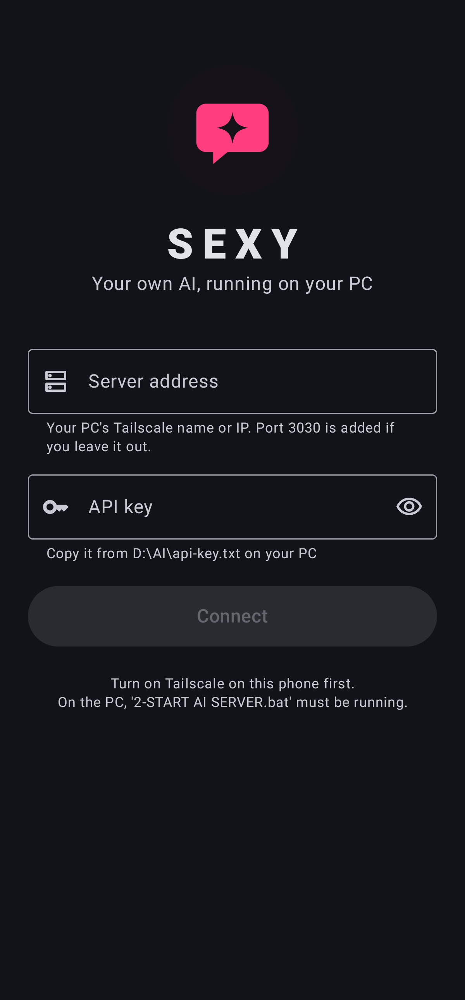
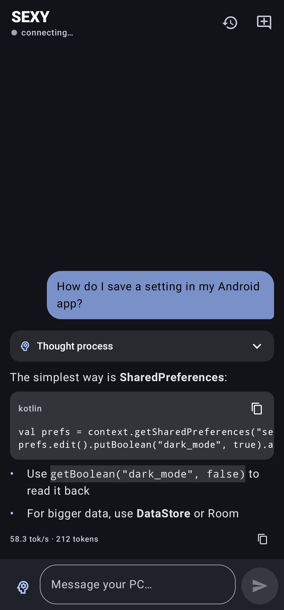
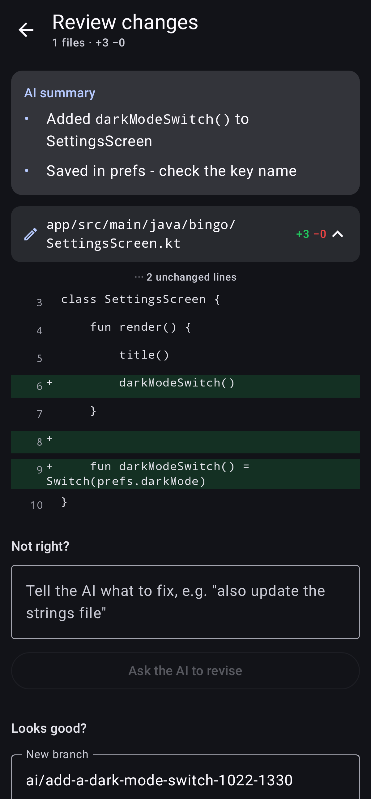

# SEXY

Android app for talking to **your own AI** running on your PC (llama.cpp `llama-server`), over Tailscale. Connect once with your server address and API key, like Immich, and then:

- **Chat** with streamed answers, an optional "thinking" view, Markdown and code blocks, tokens per second, and saved history.
- **GitHub**: pick a repo (for example BingO), choose the files and describe the task. Your PC's AI writes the changes and you review a colored diff. The app then commits to a **new branch** and opens a **pull request**, so `main` is never touched. One tap copies a review request for Claude.

| Connect | Chat | Review AI changes |
|---|---|---|
|  |  |  |

## Setup

1. On the PC, run `D:\AI\2-START AI SERVER.bat`. It serves on `127.0.0.1:3030` and is shared to your tailnet with `tailscale serve`.
2. On the phone, turn on Tailscale and install the APK. Enter `desktop-d0efhda` (port 3030 is added automatically) and the key from `D:\AI\api-key.txt`.
3. For GitHub, create a fine-grained token in the app's **GitHub** tab with Contents and Pull requests set to *Read and write* on the repos you pick.

## How the GitHub flow works

1. The app downloads the files you selected (plus `AGENTS.md` if the repo has one) through the GitHub API.
2. The local model gets a strict format: full files between `<<<FILE path>>>` and `<<<END>>>`, plus `<<<DELETE path>>>` for deletions.
3. The app parses those files, diffs them against the originals and shows you the result. You can ask for revisions as often as you like.
4. **Commit and open pull request** makes one commit on `ai/<task>-<date>` (Git Data API) and opens a pull request. It's a draft PR where GitHub allows drafts, otherwise a normal one.

Limits: input is capped at about 40k tokens because the server uses a 64k context. Pick only the files the task needs.

## Build

```bash
./gradlew testDebugUnitTest   # unit, network (MockWebServer) and screenshot tests (Robolectric + Roborazzi)
./gradlew assembleRelease     # app/build/outputs/apk/release/app-release.apk
```

Release signing reads `keystore.properties` (not committed) or the `SIGNING_*` environment variables. GitHub Actions builds an APK on every push (see the **Actions** tab → artifact `SEXY-apk`). Pushing a tag like `v1.0` publishes a GitHub Release. Add the signing secrets listed in `.github/workflows/build.yml` so every build installs as an update.

Stack: Kotlin, Jetpack Compose (Material 3 / Material You), OkHttp (SSE streaming) and kotlinx.serialization. The API key and GitHub token are encrypted with the Android Keystore.
