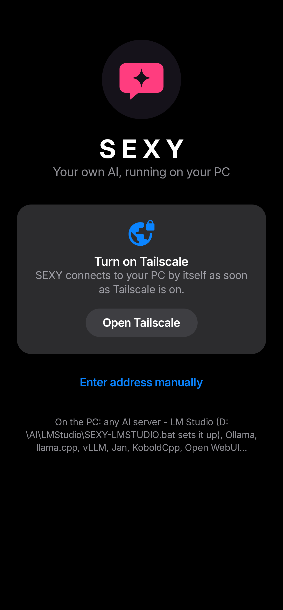
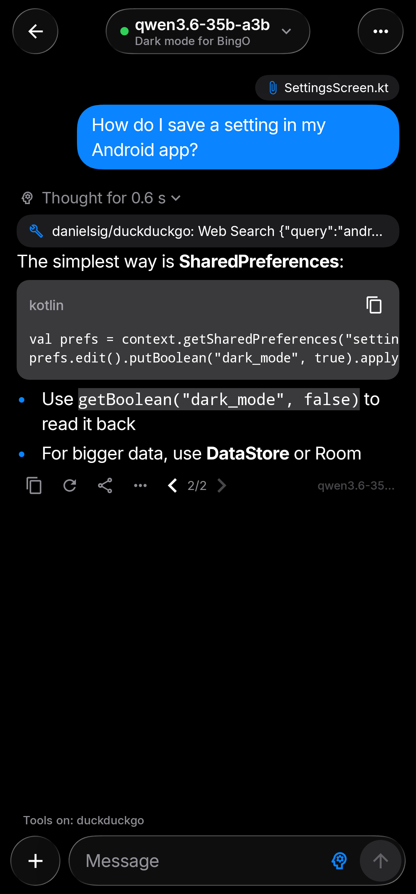
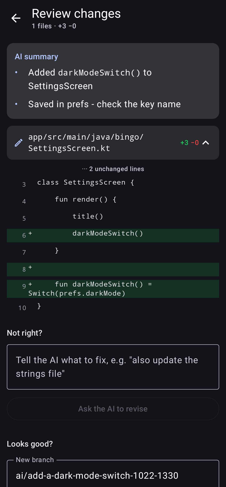

# SEXY

Android app for talking to **your own AI** running on your PC in **LM Studio**, over Tailscale. Turn Tailscale on and the app finds your PC by itself - no address or key to type. Then:

- **Chat** like ChatGPT: pick any of your LM Studio models from the menu under the title (models that aren't loaded yet load when you send a message), streamed answers, an optional "thinking" view, Markdown and code blocks, tokens per second, and saved history.
- **GitHub**: pick a repo (for example BingO), choose the files and describe the task. Your PC's AI writes the changes and you review a colored diff. The app then commits to a **new branch** and opens a **pull request**, so `main` is never touched. One tap copies a review request for Claude.

| Connect | Chat | Review AI changes |
|---|---|---|
|  |  |  |

## Setup

1. On the PC, run `D:\AI\tools\SEXY-SERVER-SETUP.bat` once. It starts LM Studio's server on `127.0.0.1:1234`, shares it with your tailnet using `tailscale serve --http=1234` (no firewall port is opened), and starts the server at every login.
2. On the phone, install the APK and turn on Tailscale. SEXY looks for `desktop-d0efhda` and its Tailscale IP on ports 1234 (LM Studio) and 3030 (old llama-server) and connects to whatever answers. It searches again whenever Tailscale turns on or you come back to the app.
3. Another PC? Tap **Enter address manually** and type its Tailscale name; it's remembered for automatic search. An API key is only needed if you turn on API tokens in LM Studio.
4. For GitHub, create a fine-grained token in the app's **GitHub** tab with Contents and Pull requests set to *Read and write* on the repos you pick.

## How the GitHub flow works

1. The app downloads the files you selected (plus `AGENTS.md` if the repo has one) through the GitHub API.
2. The local model gets a strict format: full files between `<<<FILE path>>>` and `<<<END>>>`, plus `<<<DELETE path>>>` for deletions.
3. The app parses those files, diffs them against the originals and shows you the result. You can ask for revisions as often as you like.
4. **Commit and open pull request** makes one commit on `ai/<task>-<date>` (Git Data API) and opens a pull request. It's a draft PR where GitHub allows drafts, otherwise a normal one.

Limits: input is capped at about 16k tokens because LM Studio is set to a 32k context (the AI's answer has to fit too). Pick only the files the task needs, or raise the context length in LM Studio.

## Build

```bash
./gradlew testDebugUnitTest   # unit, network (MockWebServer) and screenshot tests (Robolectric + Roborazzi)
./gradlew assembleRelease     # app/build/outputs/apk/release/app-release.apk
```

Release signing reads `keystore.properties` (not committed) or the `SIGNING_*` environment variables. GitHub Actions builds an APK on every push (see the **Actions** tab → artifact `SEXY-apk`). Pushing a tag like `v1.0` publishes a GitHub Release. Add the signing secrets listed in `.github/workflows/build.yml` so every build installs as an update.

Stack: Kotlin, Jetpack Compose (Material 3 / Material You), OkHttp (SSE streaming) and kotlinx.serialization. The API key and GitHub token are encrypted with the Android Keystore.
