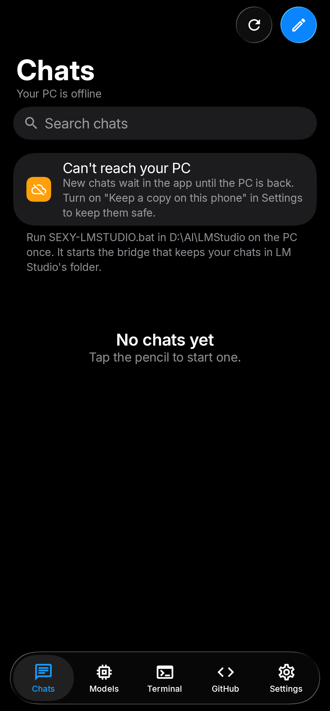
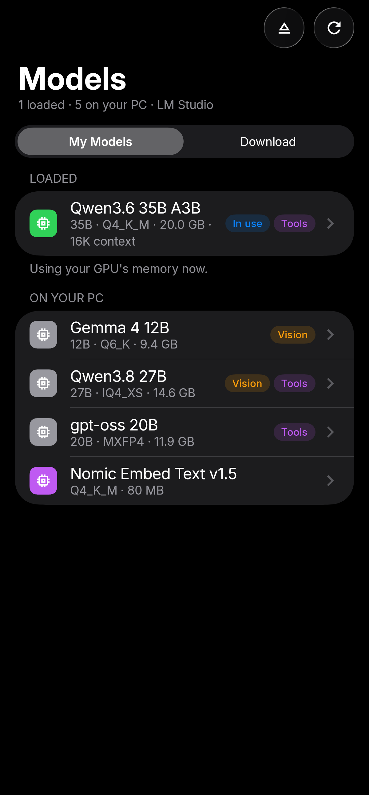
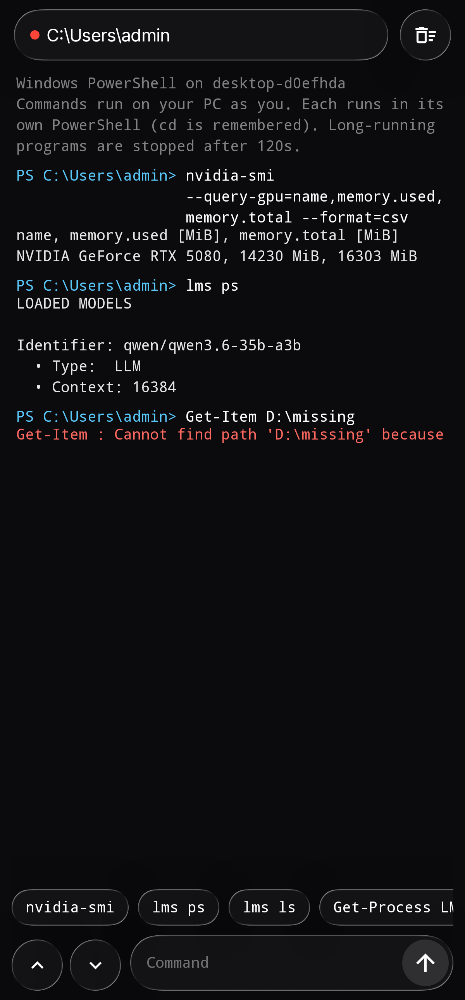

# SEXY

LM Studio in your pocket. An Android app with an iOS 26 **Liquid Glass** look for talking to **your own AI** on your PC over Tailscale. Turn Tailscale on and the app finds your PC by itself.

- **Chats live on your PC, in LM Studio's own chat folder.** A chat you start on the phone shows up in LM Studio on the PC and the other way round. The phone keeps no copy unless you turn on *Keep a copy on this phone*. If the PC is offline, new chats wait and are sent when it's back; if a chat changed on both sides, the app merges them (or keeps both).
- **Everything LM Studio has:** pick any model, load/eject it with its settings (context length, Flash Attention, KV cache on GPU, experts, batch size), download new models, per-chat system prompt and sampling (temperature, top-p, top-k, min-p, repeat penalty, max tokens, seed), thinking levels, images for vision models, file attachments (stored on the PC; text, code, PDF and Office files are read and given to the model), your LM Studio **plugins / MCP tools**, regenerate, edit and resend, and every answer version.
- **Terminal:** PowerShell on your PC from the phone (only through your Tailscale login).
- **Any AI server:** besides LM Studio it recognises Ollama, llama.cpp, vLLM, Jan, KoboldCpp, text-generation-webui, GPT4All, LocalAI and Open WebUI on their usual ports.
- **GitHub:** pick a repo, choose files and describe the task. Your PC's AI writes the changes, you review a coloured diff, and the app opens a pull request on a new branch.

| Home | Chat | Models | Terminal |
|---|---|---|---|
|  |  |  |  |

## Setup

1. Copy `pc/SEXY-LMSTUDIO.bat` and `pc/sexy-bridge.ps1` into your LM Studio folder (`D:\AI\LMStudio`, next to `.lmstudio`) and run the `.bat` once. It:
   - stops the old llama-server (port 3030),
   - starts LM Studio's server on `127.0.0.1:1234` and the **SEXY bridge** on `127.0.0.1:1235`,
   - shares both with your tailnet only (`tailscale serve --http=1234` / `--http=1235`, no firewall ports opened),
   - starts both at every login.
2. In LM Studio → Developer → Server settings, turn on **Allow calling servers from mcp.json** if you want plugins/tools from the phone.
3. On the phone, install the APK and turn on Tailscale. SEXY looks for `desktop-d0efhda` (and its Tailscale IP) on every popular AI server port and connects to what answers, LM Studio first.
4. Another PC? Tap **Enter address manually** and type its Tailscale name. An API key is only needed if you turn on API tokens in LM Studio (or for Open WebUI).
5. For GitHub, create a fine-grained token in the app's **GitHub** tab with Contents and Pull requests set to *Read and write* on the repos you pick.

### The PC bridge (`pc/sexy-bridge.ps1`)

Plain Windows PowerShell, nothing to install. It listens on 127.0.0.1 only and is shared through `tailscale serve`.

| Endpoint | What it does |
|---|---|
| `GET /conversations` | LM Studio's chats (name, pinned, times, model, tokens) |
| `GET/PUT/DELETE /conversations/<id>` | read / save (with conflict check) / move to `sexy-trash` |
| `GET /plugins` | LM Studio plugins and `mcp.json` servers |
| `PUT /files/<name>`, `GET /files` | uploads, kept in `sexy-uploads` next to LM Studio |
| `POST /terminal` | runs a PowerShell command; only accepted with Tailscale's `Tailscale-User-Login` header. Create an empty `sexy-terminal-off` file to turn it off. |

How chats are sent to the model: normal chats use LM Studio's OpenAI-compatible `/v1/chat/completions` with the full history (exactly what's in the chat). Chats with plugins switched on use LM Studio's `/api/v1/chat`, which runs the tools on the PC.

## How the GitHub flow works

1. The app downloads the files you selected (plus `AGENTS.md` if the repo has one) through the GitHub API.
2. The local model gets a strict format: full files between `<<<FILE path>>>` and `<<<END>>>`, plus `<<<DELETE path>>>` for deletions.
3. The app parses those files, diffs them against the originals and shows you the result. You can ask for revisions as often as you like.
4. **Commit and open pull request** makes one commit on `ai/<task>-<date>` (Git Data API) and opens a pull request. It's a draft PR where GitHub allows drafts, otherwise a normal one.

Limits: input is capped at about 16k tokens because LM Studio is set to a 32k context (the AI's answer has to fit too). Pick only the files the task needs, or raise the context length in LM Studio.

## Build

```bash
./gradlew testDebugUnitTest   # unit, network (MockWebServer) and screenshot tests (Robolectric + Roborazzi)
./gradlew assembleRelease     # app/build/outputs/apk/release/app-release.apk
```

Release signing reads `keystore.properties` (not committed) or the `SIGNING_*` environment variables. GitHub Actions builds an APK on every push (see the **Actions** tab → artifact `SEXY-apk`). Pushing a tag like `v1.0` publishes a GitHub Release. Add the signing secrets listed in `.github/workflows/build.yml` so every build installs as an update.

Stack: Kotlin, Jetpack Compose, [Kyant0/AndroidLiquidGlass](https://github.com/Kyant0/AndroidLiquidGlass) (Liquid Glass, Apache 2.0), the Inter font (SIL OFL), PdfBox-Android, OkHttp (SSE streaming) and kotlinx.serialization. The API key and GitHub token are encrypted with the Android Keystore.
